> ✏️ **This page is auto-generated from [`start_here.py`](../start_here.py) — do not edit it directly.**
> It shows the example fully executed, with its real output images.
> Run it yourself via the [Python script](../start_here.py) or the [Jupyter notebook](../start_here.ipynb).

PyAutoGalaxy
=============

**PyAutoGalaxy** models galaxy structure and morphology, from bulge–disc decomposition to comparisons across wavebands. You can fit individual galaxies or large samples, using imaging and interferometer observations.


__Using This Guide__

This notebook gives an overview of the **PyAutoGalaxy Python API**, including how to import `autogalaxy`, create light profiles and galaxies, and simulate and fit galaxy images. You can read through the examples or run the cells below, either locally or in your web browser using [Google Colab](https://colab.research.google.com/github/PyAutoLabs/autogalaxy_workspace/blob/2026.11.13.1/start_here.ipynb).

If you use AI, the [PyAutoGalaxy AI Assistant](https://github.com/PyAutoLabs/autogalaxy_assistant) can give you an interactive walkthrough. Paste this prompt into Claude Code, Codex or another AI coding agent:

> I want to study galaxy structure and morphology with PyAutoGalaxy
> (https://github.com/PyAutoLabs/PyAutoGalaxy) and the
> autogalaxy_assistant (https://github.com/PyAutoLabs/autogalaxy_assistant).
>
> First clone the assistant repository, cd into it and follow its AGENTS.md.
> Begin the "start here" guide for a new user.

See [AI Options](https://github.com/PyAutoLabs/PyAutoScientist/blob/main/AI_OPTIONS.md) for tools and setup guidance.

__Google Colab Setup__

Run this cell to install PyAutoGalaxy and download the files needed for this notebook on Google Colab.
If you’re running locally or in HTML, it leaves your installation unchanged.


```python

from autogalaxy import setup_colab
setup_colab.for_autogalaxy(raise_error_if_not_gpu=False)
```


__Imports__

Lets first import autolens, its plotting module and the other libraries we'll need.

You'll see these imports in the majority of workspace examples.


```python
import autogalaxy as ag
import autogalaxy.plot as aplt

import matplotlib.pyplot as plt
from pathlib import Path
```

Lets illustrate a simple galaxy structure calculations creating an an image of a galaxy using a light profile.

__Grid__

The emission of light from a galaxy is described using the `Grid2D` data structure, which is two-dimensional
Cartesian grids of (y,x) coordinates where the light profile of the galaxy is evaluated on the grid.

We make and plot a uniform Cartesian grid:


```python
grid = ag.Grid2D.uniform(
    shape_native=(150, 150),  # The [pixels x pixels] shape of the grid in 2D.
    pixel_scales=0.05,  # The pixel-scale describes the conversion from pixel units to arc-seconds.
)

aplt.plot_grid(grid=grid, title="Uniform Grid")
```


    
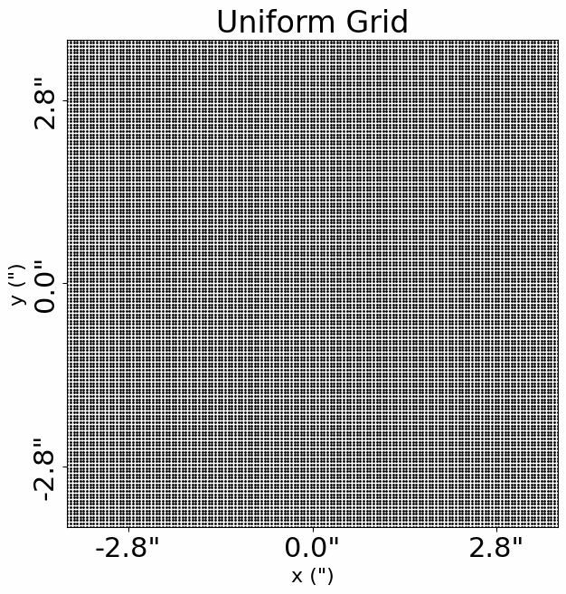
    


__Light Profiles__

Our aim is to create an image of the morphological structures that make up a galaxy.

This uses analytic functions representing a galaxy's light, referred to as `LightProfile` objects. 

The most common light profile in Astronomy is the elliptical Sersic, which we create an instance of below:


```python
sersic_light_profile = ag.lp.Sersic(
    centre=(0.0, 0.0),  # The light profile centre [units of arc-seconds].
    ell_comps=(
        0.2,
        0.1,
    ),  # The light profile elliptical components [can be converted to axis-ratio and position angle].
    intensity=0.005,  # The overall intensity normalisation [units arbitrary and are matched to the data].
    effective_radius=2.0,  # The effective radius containing half the profile's total luminosity [units of arc-seconds].
    sersic_index=4.0,  # Describes the profile's shape [higher value -> more concentrated profile].
)
```

By passing the light profile the `grid`, we evaluate the light emitted at every (y,x) coordinate and therefore create 
an image of the Sersic light profile.


```python
image = sersic_light_profile.image_2d_from(grid=grid)

plt.imshow(image.native)  # Dont worry about the use of .native for now.
```


    <matplotlib.image.AxesImage at 0x7f4c2bca7cb0>


    
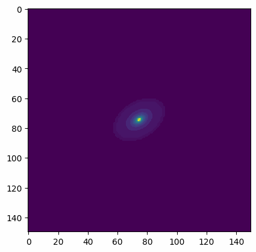
    


__Plotting__

In-built plotting methods are provided for plotting objects and their properties, like the image of
a light profile we just created.

By using the plot module, the image is improved: axis units are scaled to arc-seconds, a color-bar is added,
descriptive labels are included, etc.

The plot module is highly customizable and designed to make it straight forward to create clean and informative figures
for fits to large datasets.


```python
aplt.plot_array(
    array=sersic_light_profile.image_2d_from(grid=grid),
    title="Sersic Light Profile Image",
)
```


    
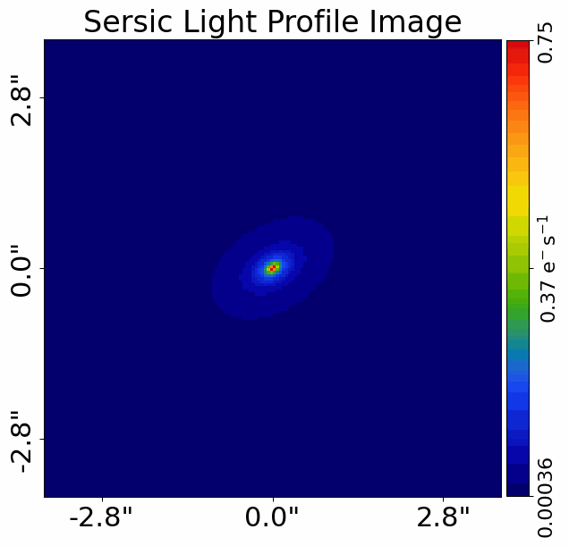
    


__Galaxy__

A `Galaxy` object is a collection of light profiles at a specific redshift.

This object is highly extensible and is what ultimately allows us to fit complex models to galaxy images.

Below, we combine the Sersic light profile above with an Exponential light profile to create a galaxy containing both
a bulge and disk component.


```python
exponential_light_profile = ag.lp.Exponential(
    centre=(0.0, 0.0), ell_comps=(0.1, 0.0), intensity=0.1, effective_radius=0.5
)

galaxy = ag.Galaxy(
    redshift=0.5, bulge=sersic_light_profile, disk=exponential_light_profile
)

aplt.plot_array(array=galaxy.image_2d_from(grid=grid), title="Galaxy Image")
```


    
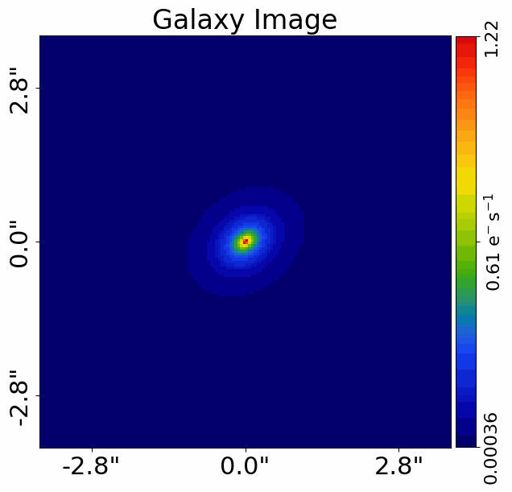
    


The individual light profiles of the galaxy can be plotted on a subplot.


```python
aplt.subplot_galaxy_light_profiles(galaxy=galaxy, grid=grid)
```


    
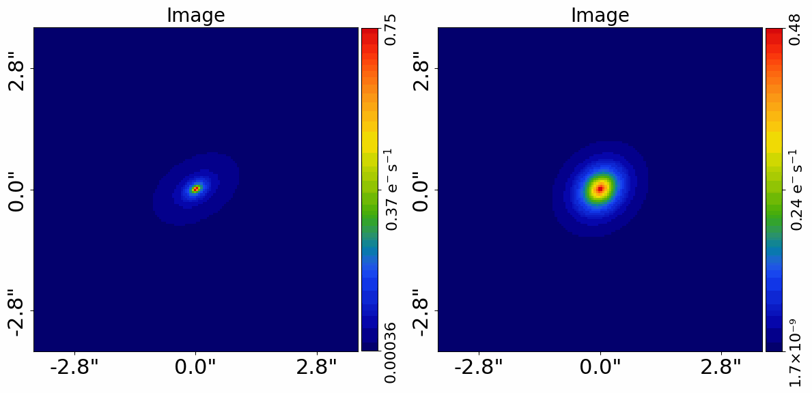
    


__Galaxies__

The `Galaxies` object is a collection of galaxies at the same redshift.

In a moment, we will see it is integral to the model-fitting API. 

For now, lets use it to create an image of a pair of merging galaxies, noting that a more concise API for creating
the galaxy is used below where the `Sersic` is passed directly to the `Galaxy` object.


```python
galaxy_1 = ag.Galaxy(
    redshift=0.5,
    bulge=ag.lp.Sersic(
        centre=(0.5, 0.2), intensity=1.0, effective_radius=1.0, sersic_index=2.0
    ),
)

galaxies = ag.Galaxies(
    galaxies=[galaxy, galaxy_1],
)

aplt.plot_array(array=galaxies.image_2d_from(grid=grid), title="Galaxies Image")
```


    
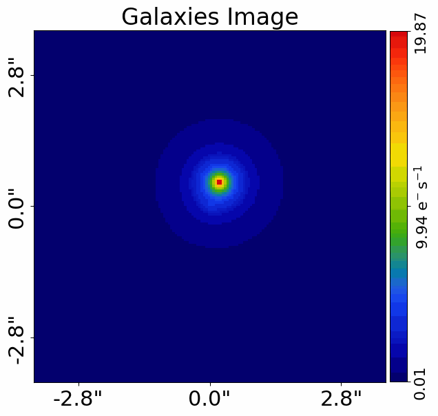
    


__JAX__

**PyAutoGalaxy** runs on either **NumPy** (the default) or **JAX** (Google's
array library with GPU support and just-in-time compilation). JAX makes
galaxy model-fitting 10-100x faster on large grids — sometimes more on GPU.

You do not have to do anything to use it. JAX installs with `autogalaxy`
by default (`pip install autogalaxy`), and the analysis objects you'll
meet in the `__Galaxy Modeling__` section below use JAX automatically. The first time a model-fit starts you'll see a one-time
log line like `JAX: Applying vmap and jit to likelihood function -- may
take a few seconds.` — that's JAX compiling the likelihood function, after
which every evaluation re-uses the compiled code. If JAX is not installed,
the analysis warns once and falls back to NumPy automatically.

That is all a new user needs to know: install the extra, and model-fitting
is fast. Everything else — disabling JAX, writing `@jax.jit` code yourself
and how JAX changes the arrays inside results — is covered in the
`scripts/guides/using_jax.py` guide.

__Units__

The units used throughout the galaxy structure literature vary, therefore lets quickly describe the units used in
**PyAutoGalaxy**.

Most distance quantities, like an `effective_radius` are quantities in terms of angles, which are defined in units
of arc-seconds. To convert these to physical units (e.g. kiloparsecs), we use the redshift of the galaxy and an 
input cosmology. A run through of all normal unit conversions is given in guides in the workspace outlined below.

The use of angles in arc-seconds has an important property, it means that calculations are independent of
the galaxy's redshifts and the input cosmology. This has a number of benefits, for example it makes it straight
forward to compare the properties of different galaxies even when the redshifts of the galaxies are unknown.

__Extensibility__

All of the objects we've introduced so far are highly extensible, for example a galaxy can be made up of any number of
light profiles and many galaxy objects can be combined into a galaxies object.

To further illustrate this, we create a merging galaxy system with 4 star forming clumps of light, using a 
`SersicSph` profile to make each spherical.


```python
galaxy_0 = ag.Galaxy(
    redshift=0.5,
    bulge=ag.lp.Sersic(
        centre=(0.0, 0.0),
        ell_comps=ag.convert.ell_comps_from(axis_ratio=0.9, angle=45.0),
        intensity=0.2,
        effective_radius=0.8,
        sersic_index=4.0,
    ),
    disk=ag.lp.Exponential(
        centre=(0.0, 0.0),
        ell_comps=ag.convert.ell_comps_from(axis_ratio=0.7, angle=30.0),
        intensity=0.1,
        effective_radius=1.6,
    ),
    extra_galaxy_0=ag.lp.SersicSph(
        centre=(1.0, 1.0), intensity=0.5, effective_radius=0.2
    ),
    extra_galaxy_1=ag.lp.SersicSph(
        centre=(0.5, 0.8), intensity=0.5, effective_radius=0.2
    ),
    extra_galaxy_2=ag.lp.SersicSph(
        centre=(-1.0, -0.7), intensity=0.5, effective_radius=0.2
    ),
    extra_galaxy_3=ag.lp.SersicSph(
        centre=(-1.0, 0.4), intensity=0.5, effective_radius=0.2
    ),
)

galaxy_1 = ag.Galaxy(
    redshift=0.5,
    bulge=ag.lp.Sersic(
        centre=(0.0, 1.0),
        ell_comps=(0.0, 0.1),
        intensity=0.1,
        effective_radius=0.6,
        sersic_index=3.0,
    ),
)

galaxies = ag.Galaxies(galaxies=[galaxy_0, galaxy_1])

aplt.plot_array(array=galaxies.image_2d_from(grid=grid), title="Galaxies Image")
```


    
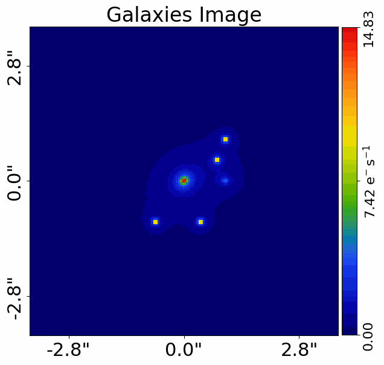
    


__Galaxy Modeling__

Galaxy modeling is the process of fitting a physical model to imaging data in order to infer the structural
and photometric properties of galaxies, such as their light distribution, size, shape, and orientation.

The primary goal of **PyAutoGalaxy** is to make galaxy modeling **simple, scalable to large datasets, and fast**,
with GPU acceleration provided via JAX.

The animation below illustrates the galaxy modeling workflow. Many models are fitted to the data iteratively,
progressively improving the quality of the fit until the model closely reproduces the observed image.

NOTE: Placeholder showing strong lens modeling animation used currently.


**Credit: Amy Etherington**

The next documentation page guides you through galaxy modeling for a variety of data types (e.g. CCD imaging at 
different resolutions) and scientific use-cases (e.g. galaxy morphology studies, bulge–disk decomposition).

__Simulations__

Simulating galaxy images is often essential, for example to:

- Practice galaxy modeling before working with real data.
- Generate large training sets (e.g. for machine learning).
- Test galaxy formation and structural models in a fully controlled environment.

The next documentation page guides you through how to simulate galaxies for different types of data
(e.g. CCD imaging) and different modeling goals (e.g. single-component galaxies, multi-component systems).

__Wrap Up__

This completes the introduction to **PyAutoGalaxy**, including a brief overview of the core API for galaxy light
profiles, galaxy modeling, and data simulation.

__Where To Next__

**PyAutoGalaxy** models the light of galaxies, from an individual galaxy to blended systems and crowded cluster fields. Your starting example depends on which galaxies you need to model together and the observations you want to analyse.

The **autogalaxy_workspace** contains Jupyter Notebooks that introduce the modelling workflow using example datasets, with Python code you can read, run and adapt. Start by choosing the galaxy system below, then your dataset type where appropriate. You can explore an example before preparing your own data.

If you would like help along the way, describe your galaxies and observations to the [PyAutoGalaxy AI Assistant](https://github.com/PyAutoLabs/autogalaxy_assistant). It can suggest a starting notebook, explain the code and help you adapt the example to your science case.

<a id="what-scale-system"></a>
__Which galaxies need modelling?__

Start with the galaxies whose light contributes to the region you want to analyse. You might be studying one galaxy, separating the overlapping light of neighbours, or modelling many galaxies across a cluster field.

The choice depends on which objects need to be fitted together, rather than simply how many appear in the image. For a single galaxy, continue to the dataset choices below. The other cards take you straight to their starting notebooks.

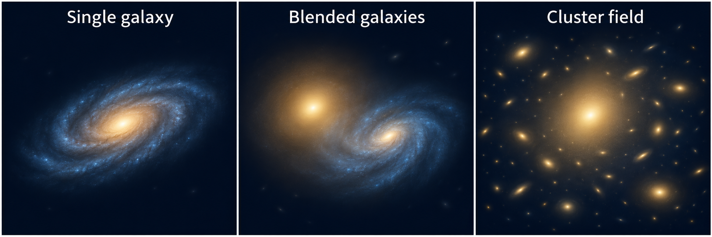

*AI-generated conceptual illustration, not observations or fitted models. Panels are not shown at the same angular scale.*

__Single galaxy__

One galaxy is the target of your analysis.

[Choose your data type below](#what-dataset-type)

__Blended galaxies__

Two or more galaxies have overlapping light.

[Notebook](https://github.com/PyAutoLabs/autogalaxy_workspace/blob/main/notebooks/multi_galaxy/start_here.ipynb) · [Google Colab](https://colab.research.google.com/github/PyAutoLabs/autogalaxy_workspace/blob/2026.11.13.1/notebooks/multi_galaxy/start_here.ipynb)

__Cluster field__

A bright central galaxy and surrounding cluster members.

[Notebook](https://github.com/PyAutoLabs/autogalaxy_workspace/blob/main/notebooks/cluster/start_here.ipynb) · [Google Colab](https://colab.research.google.com/github/PyAutoLabs/autogalaxy_workspace/blob/2026.11.13.1/notebooks/cluster/start_here.ipynb)

These examples model the galaxies’ own light, including in cluster fields. If your goal is to model gravitational lensing and the distorted images of background sources, start with [PyAutoLens](https://pyautolens.readthedocs.io/en/latest/overview/overview_2_new_user_guide.html).

<a id="what-dataset-type"></a>
__What dataset type?__

For a single galaxy, choose the notebook that matches your observations. A telescope image, interferometer measurements and images taken in several wavebands each call for a different starting workflow.

Each notebook begins with example data and introduces the relevant model and fitting steps. If you do not have your own dataset yet, choose the example closest to your interests. For blended galaxies or cluster fields, begin with the system-specific guide above.

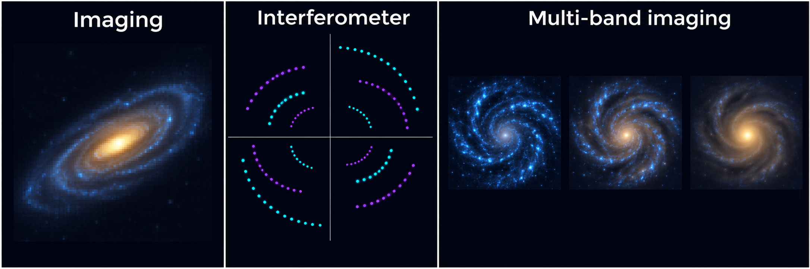

*AI-generated schematic, not measured data. The interferometer panel shows sampling locations; multi-band images illustrate how the relative prominence of a galaxy’s components can change with wavelength.*

__Imaging__

Galaxy images from Hubble, JWST or ground-based telescopes.

[Notebook](https://github.com/PyAutoLabs/autogalaxy_workspace/blob/main/notebooks/imaging/start_here.ipynb) · [Google Colab](https://colab.research.google.com/github/PyAutoLabs/autogalaxy_workspace/blob/2026.11.13.1/notebooks/imaging/start_here.ipynb)

__Interferometer__

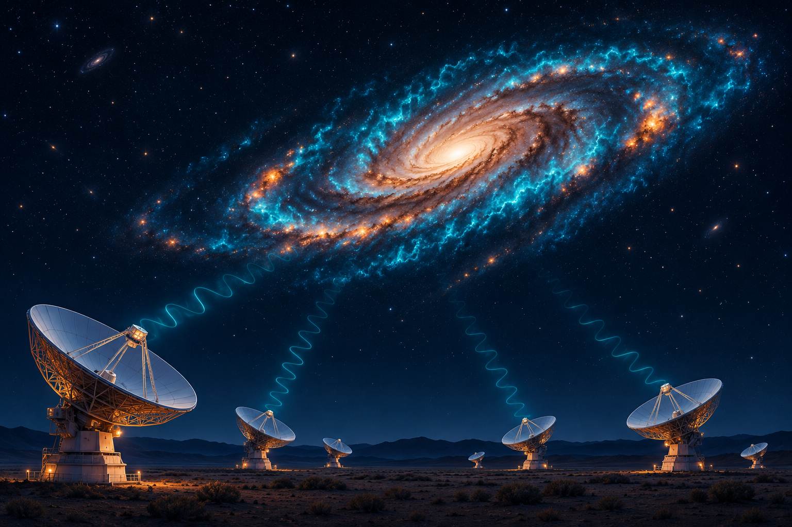

Radio or submillimetre observations, such as ALMA visibilities.

[Notebook](https://github.com/PyAutoLabs/autogalaxy_workspace/blob/main/notebooks/interferometer/start_here.ipynb) · [Google Colab](https://colab.research.google.com/github/PyAutoLabs/autogalaxy_workspace/blob/2026.11.13.1/notebooks/interferometer/start_here.ipynb)

__Multi-band imaging__

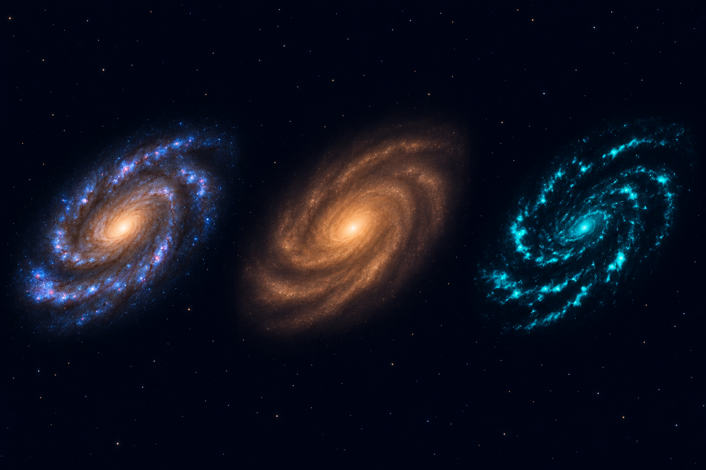

Images of the same galaxy in several wavebands.

[Notebook](https://github.com/PyAutoLabs/autogalaxy_workspace/blob/main/notebooks/multi_dataset/start_here.ipynb) · [Google Colab](https://colab.research.google.com/github/PyAutoLabs/autogalaxy_workspace/blob/2026.11.13.1/notebooks/multi_dataset/start_here.ipynb)

Combining wavebands can help you study colour gradients and how a galaxy’s apparent structure changes with wavelength. The multi-band example introduces fitting those observations together.

<a id="google-colab"></a>
__Open and run an example__

The **Notebook** links open a readable preview on GitHub. You can browse the explanations and code there before deciding which example to try.

To run an example in your browser, choose **Google Colab**. Run its setup cell first to install the software and prepare the example, then work through the notebook in order. This lets you try PyAutoGalaxy without setting up a local installation.

If you already have PyAutoGalaxy installed and a local copy of the workspace, open the same notebook in Jupyter on your machine. Start with the supplied dataset so you can follow the complete workflow, then adapt it to your own observations.

__Still unsure?__

You do not need to settle every modelling choice before getting started. Browse the introductions to a couple of notebooks and choose the one closest to your galaxies and observations. The starting examples establish the workflow; more specialised choices can come later.

You can also tell the [AI Assistant](https://github.com/PyAutoLabs/autogalaxy_assistant) which galaxies overlap in your field, what data you have and what you hope to measure. It can help you find the most relevant example.

<a id="howtogalaxy"></a>
__Learn the science__

The starting examples introduce how to use PyAutoGalaxy. If galaxy light profiles or Bayesian modelling are new to you, you may also want a slower explanation of how these models describe galaxy structure and how their parameters are inferred from data.

[HowToGalaxy](https://github.com/PyAutoLabs/HowToGalaxy) develops these ideas through worked Jupyter Notebooks. It is particularly useful for students and researchers beginning galaxy modelling, and you can work through it alongside the workspace examples.

If you already know the underlying science, begin with the example for your observations and return to HowToGalaxy whenever you want more background.

<a id="wrap-up"></a>
__Next steps__

First, work through your chosen starting notebook and become familiar with its data, model and results. Then explore the [Features guide](https://pyautogalaxy.readthedocs.io/en/latest/overview/overview_3_features.html) for additional modelling tools suited to your science, with links to detailed introductions and worked examples.

__Features__

Explore the modelling tools you can add to your analysis. Each introduction explains the scientific use cases and links to worked examples.

For your first dataset and starting notebook, use the [New User Guide](https://autogalaxy.readthedocs.io/en/latest/overview/overview_2_new_user_guide.html).

<table class="feature-gallery"><tbody><tr><td width="25%"><a href="#multi-gaussian-expansion-mge"><br>MGE</a></td><td width="25%"><a href="#pixelizations"><br>Pixelizations</a></td><td width="25%"><a href="#shapelets"><br>Shapelets</a></td><td width="25%"><a href="#ellipse-fitting"><br>Ellipse Fitting</a></td></tr></tbody></table>

*Conceptual illustrations, not measured data or guaranteed reconstructions.*

<details class="feature-more-images"><summary>More feature illustrations</summary><table class="feature-gallery"><tbody><tr><td width="25%"><a href="#linear-light-profiles"><br>Linear Light Profiles</a></td><td width="25%"><a href="#extra-galaxies"><br>Extra Galaxies</a></td><td width="25%"><a href="#point-source"><br>Point Source</a></td><td width="25%"><a href="#operated-light-profiles"><br>Operated Light Profiles</a></td></tr><tr><td width="25%"><a href="#sky-background"><br>Sky Background</a></td><td width="25%"><a href="#interferometry"><br>Interferometry</a></td><td width="25%"><a href="#multi-wavelength"><br>Multi-Wavelength</a></td></tr></tbody></table></details>

__Measure galaxy structure__

<div id="multi-gaussian-expansion-mge" class="feature-entry"><h3>Multi Gaussian Expansion (MGE)</h3><p>Describe central and extended galaxy light with a sum of Gaussians. An MGE captures changes in shape with radius while solving component brightnesses together, providing a flexible alternative to a small set of light profiles.</p>
<p><a href="https://github.com/PyAutoLabs/autogalaxy_workspace/blob/main/notebooks/imaging/features/multi_gaussian_expansion/start_here.ipynb">Explore multi gaussian expansion (mge)</a>.</p>
</div>

<div id="pixelizations" class="feature-entry"><h3>Pixelizations</h3><p>Reconstruct clumpy or asymmetric galaxy light on a mesh when a few analytic profiles are too restrictive. The data, mesh and regularization determine which structures can be recovered.</p>
<p><a href="https://github.com/PyAutoLabs/autogalaxy_workspace/blob/main/notebooks/imaging/features/pixelization/start_here.ipynb">Start with pixelization</a>.</p>
</div>

<div id="shapelets" class="feature-entry"><h3>Shapelets</h3><p>Study asymmetric morphology and structured residuals using a sum of spatial basis functions. Shapelet order, scale and geometry control the flexibility; assess the combined brightness distribution rather than treating individual basis modes as physical components.</p>
<p><a href="https://github.com/PyAutoLabs/autogalaxy_workspace/blob/main/notebooks/imaging/features/shapelets/start_here.ipynb">Explore shapelets</a>.</p>
</div>

<div id="ellipse-fitting" class="feature-entry"><h3>Ellipse Fitting</h3><p>Measure how a galaxy’s ellipticity, position angle and centre change with radius without imposing a radial light-profile law. Add multipoles to study lopsided or non-elliptical isophotes. This dedicated PyAutoGalaxy capability fits observed light; the examples do not convolve a light model with the PSF.</p>
<p><a href="https://github.com/PyAutoLabs/autogalaxy_workspace/blob/main/notebooks/ellipse/fit.ipynb">Explore ellipse fitting</a>.</p>
<p>Continue to <a href="https://github.com/PyAutoLabs/autogalaxy_workspace/blob/main/notebooks/ellipse/modeling.ipynb">modeling</a> and <a href="https://github.com/PyAutoLabs/autogalaxy_workspace/blob/main/notebooks/ellipse/multipoles.ipynb">multipoles</a>.</p>
</div>

__Separate light components__

<div id="linear-light-profiles" class="feature-entry"><h3>Linear Light Profiles</h3><p>Fit galaxy geometry with fewer sampled parameters by solving component brightnesses together at each likelihood evaluation. This is especially useful for bulge–disc decomposition and models with many overlapping light components.</p>
<p><a href="https://github.com/PyAutoLabs/autogalaxy_workspace/blob/main/notebooks/imaging/features/linear_light_profiles/start_here.ipynb">Explore linear light profiles</a>.</p>
</div>

<div id="extra-galaxies" class="feature-entry"><h3>Extra Galaxies</h3><p>Measure a target galaxy in a crowded field by fitting neighbouring light alongside it. Separating overlapping emission helps protect the inferred size, shape and flux of the target.</p>
<p><a href="https://github.com/PyAutoLabs/autogalaxy_workspace/blob/main/notebooks/imaging/features/extra_galaxies/start_here.ipynb">Explore extra galaxies</a>.</p>
</div>

<div id="point-source" class="feature-entry"><h3>Point Source</h3><p>Simulate an unresolved nucleus inside an extended host galaxy. This example shows how compact and extended light combine after the instrumental response; it is a simulator, not a point-source fitting workflow.</p>
<p><a href="https://github.com/PyAutoLabs/autogalaxy_workspace/blob/main/notebooks/imaging/features/point_source/start_here.ipynb">Explore point source</a>.</p>
</div>

<div id="operated-light-profiles" class="feature-entry"><h3>Operated Light Profiles</h3><p>Separate compact nuclear emission from an extended host with a component that already includes the imaging PSF response. For interferometer data, the compact sky model is still transformed into visibilities.</p>
<p><a href="https://github.com/PyAutoLabs/autogalaxy_workspace/blob/main/notebooks/imaging/features/operated_light_profile/start_here.ipynb">Explore operated light profiles</a>.</p>
</div>

<div id="sky-background" class="feature-entry"><h3>Sky Background</h3><p>Measure faint galaxy outskirts while fitting an uncertain sky level alongside the galaxy light. The example fits a constant background; estimating its mean does not remove photon noise.</p>
<p><a href="https://github.com/PyAutoLabs/autogalaxy_workspace/blob/main/notebooks/imaging/features/sky_background/start_here.ipynb">Explore sky background</a>.</p>
</div>

__Combine observations and samples__

<div id="interferometry" class="feature-entry"><h3>Interferometry</h3><p>Extend visibility modelling with MGE, shapelets or pixelized galaxy light to investigate complex emission.</p>
<p><a href="https://github.com/PyAutoLabs/autogalaxy_workspace/tree/main/notebooks/interferometer/features">Interferometer features</a>.</p>
</div>

<div id="multi-wavelength" class="feature-entry"><h3>Multi-Wavelength</h3><p>Compare galaxy structure across bands and distinguish components such as a red bulge and blue disc, or stellar and dust emission. Fit datasets together with shared or wavelength-dependent parameters while preserving their individual responses and noise.</p>
<p><a href="https://github.com/PyAutoLabs/autogalaxy_workspace/blob/main/notebooks/multi_dataset/start_here.ipynb">Explore multi-wavelength</a>.</p>
</div>

<div id="graphical-models" class="feature-entry"><h3>Graphical Models</h3><p>Infer population trends by fitting galaxy datasets with shared parameters. Hierarchical models describe distributions of properties such as size or Sersic index, helping study how galaxy structure varies with mass or redshift.</p>
<p>See the <a href="https://github.com/PyAutoLabs/autofit_workspace/tree/main/notebooks/features">PyAutoFit graphical-model examples</a> for the shared-parameter API.</p>
</div>

<section class="directory" id="directory"><h2>All workspace links</h2><p class="minor">Choose your dataset to browse every feature introduction.</p><details><summary>Imaging · 8 introductions</summary><ul><li><a href="https://github.com/PyAutoLabs/autogalaxy_workspace/blob/main/notebooks/imaging/features/extra_galaxies/start_here.ipynb">Extra Galaxies</a></li><li><a href="https://github.com/PyAutoLabs/autogalaxy_workspace/blob/main/notebooks/imaging/features/linear_light_profiles/start_here.ipynb">Linear Light Profiles</a></li><li><a href="https://github.com/PyAutoLabs/autogalaxy_workspace/blob/main/notebooks/imaging/features/multi_gaussian_expansion/start_here.ipynb">Multi Gaussian Expansion</a></li><li><a href="https://github.com/PyAutoLabs/autogalaxy_workspace/blob/main/notebooks/imaging/features/operated_light_profile/start_here.ipynb">Operated Light Profile</a></li><li><a href="https://github.com/PyAutoLabs/autogalaxy_workspace/blob/main/notebooks/imaging/features/pixelization/start_here.ipynb">Pixelization</a></li><li><a href="https://github.com/PyAutoLabs/autogalaxy_workspace/blob/main/notebooks/imaging/features/point_source/start_here.ipynb">Point Source</a></li><li><a href="https://github.com/PyAutoLabs/autogalaxy_workspace/blob/main/notebooks/imaging/features/shapelets/start_here.ipynb">Shapelets</a></li><li><a href="https://github.com/PyAutoLabs/autogalaxy_workspace/blob/main/notebooks/imaging/features/sky_background/start_here.ipynb">Sky Background</a></li></ul></details><details><summary>Interferometer · 6 introductions</summary><ul><li><a href="https://github.com/PyAutoLabs/autogalaxy_workspace/blob/main/notebooks/interferometer/features/extra_galaxies/start_here.ipynb">Extra Galaxies</a></li><li><a href="https://github.com/PyAutoLabs/autogalaxy_workspace/blob/main/notebooks/interferometer/features/linear_light_profiles/start_here.ipynb">Linear Light Profiles</a></li><li><a href="https://github.com/PyAutoLabs/autogalaxy_workspace/blob/main/notebooks/interferometer/features/multi_gaussian_expansion/start_here.ipynb">Multi Gaussian Expansion</a></li><li><a href="https://github.com/PyAutoLabs/autogalaxy_workspace/blob/main/notebooks/interferometer/features/operated_light_profile/start_here.ipynb">Operated Light Profile</a></li><li><a href="https://github.com/PyAutoLabs/autogalaxy_workspace/blob/main/notebooks/interferometer/features/pixelization/start_here.ipynb">Pixelization</a></li><li><a href="https://github.com/PyAutoLabs/autogalaxy_workspace/blob/main/notebooks/interferometer/features/shapelets/start_here.ipynb">Shapelets</a></li></ul></details><details><summary>Multi dataset · 6 introductions</summary><ul><li><a href="https://github.com/PyAutoLabs/autogalaxy_workspace/blob/main/notebooks/multi_dataset/features/dataset_offsets/start_here.ipynb">Dataset Offsets</a></li><li><a href="https://github.com/PyAutoLabs/autogalaxy_workspace/blob/main/notebooks/multi_dataset/features/imaging_and_interferometer/start_here.ipynb">Imaging And Interferometer</a></li><li><a href="https://github.com/PyAutoLabs/autogalaxy_workspace/blob/main/notebooks/multi_dataset/features/one_by_one/start_here.ipynb">One By One</a></li><li><a href="https://github.com/PyAutoLabs/autogalaxy_workspace/blob/main/notebooks/multi_dataset/features/pixelization/start_here.ipynb">Pixelization</a></li><li><a href="https://github.com/PyAutoLabs/autogalaxy_workspace/blob/main/notebooks/multi_dataset/features/same_wavelength/start_here.ipynb">Same Wavelength</a></li><li><a href="https://github.com/PyAutoLabs/autogalaxy_workspace/blob/main/notebooks/multi_dataset/features/wavelength_dependence/start_here.ipynb">Wavelength Dependence</a></li></ul></details><details><summary>Multi galaxy · 1 introductions</summary><ul><li><a href="https://github.com/PyAutoLabs/autogalaxy_workspace/blob/main/notebooks/multi_galaxy/features/extra_galaxies/start_here.ipynb">Extra Galaxies</a></li></ul></details></section>
